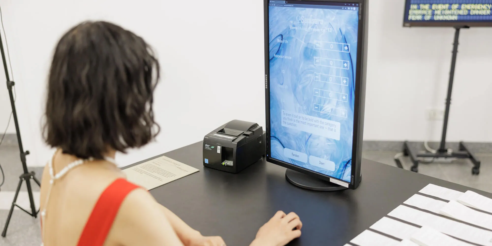

# Samsara

[](https://www.youtube.com/watch?v=SZAssoQM8Og)

♀Samsara (2022) challenges the socioeconomic frameworks woven within our optimism about gender equality. By allowing each audience to become digitally reborn as a female in the program based on their life choices, it draws attention to the parallels between the myth of meritocracy and the myth of progress, asking us to reconsider the power dynamics in the future tense. The work ushers in a sense of a future techno-dystopia where our desires are serviced by AI and human rights are sacrificed in the name of the new techno-religion.

Read more at [Planet B Exhibition at Ars Eletronica](https://ars.electronica.art/planetb/en/samsara/).


## Installation

<details>
<summary><strong>Web Version</strong></summary>
<br />

1. Installation dependence.

```bash
yarn install
```

Or

```bash
npm install
```

2. Start local server.

```bash
yarn dev
```

Or

```bash
npm run dev
```

3. After the startup is complete, will automatically open a browser and visit.
</details>

<details>
<summary><strong>Command Line Version</strong></summary>
<br />

```bash
node repl
```

</details>


## Languages

The game ships in English and Chinese (简体中文). The player picks the language with the **中文｜EN** switch under the title on the start screen; a fresh page load always starts in Chinese (`DEFAULT_LANG` in `src/lib/i18n.js`).

- `static/data/en-us/` is the original English data. It is the structure the engine runs on and is never edited for translation.
- `static/data/zh-cn/` holds text-only overlays (`events.json`: event id → line, `talents.json`: id → name/description) applied on top of it, so a translation can't change conditions, effects or branches.
- Interface strings (buttons, labels, credits, the printed receipt) live in `src/lib/i18n.js`.
- Chinese is drawn with two bundled fonts in `static/fonts/` (Noto Sans SC for all text, Yozai for the handwritten start-sequence subtitle; both SIL OFL), subset to the characters the game uses. After changing any Chinese text, rebuild them with `python3 scripts/subset-fonts.py <NotoSansSC[wght].ttf> <Yozai-Medium.ttf>` — `npm test` fails if a character is missing from the font.

To add another language: add a `DICT` entry in `i18n.js`, a data folder under `static/data/`, and register it in `OVERLAY_DIRS` in `src/lib/game/core.js`. `npm test` checks that every event id and interface key is covered.

## 展场布展操作手册（本地运行）

游戏在展场电脑上本地运行，**不需要联网**：视频、声音、字体、二维码全部在本机。联网时会把每局结果上报到数据库，断网时只是不上报，游戏照常玩、小票照常打。

### 一、首次准备（技术人员做一次即可）

1. 安装 [Node.js](https://nodejs.org/)（选 LTS 版本）和 [Google Chrome](https://www.google.com/chrome/)。
2. 把整个项目文件夹拷到展场电脑上（例如桌面），在文件夹里打开终端运行一次：
   ```bash
   npm install --legacy-peer-deps
   ```
3. 在项目文件夹里放好 `.env` 文件（数据上报的地址和 key，向开发者要）。没有这个文件也能玩，只是不上报数据。
4. 小票打印机（58mm 热敏）：装好驱动，在系统设置里**设为默认打印机**，纸张选 58mm。
5. 试运行一次（见下文第二部分），完整玩一局并打印一张小票，确认能出纸。
6. 建议在系统里关闭自动休眠和屏保、关闭系统更新提示，避免展出时弹窗。

### 二、每天开馆

1. **双击项目文件夹里的启动文件**：
   - Windows：`start-exhibit.bat`
   - Mac：`start-exhibit.command`（第一次如果提示无法打开：右键 → 打开）
2. 会弹出一个黑色窗口，显示「正在构建游戏」，等 10–30 秒。
3. 之后 Chrome 会自动**全屏**打开游戏。看到 ♀Samsara 标题画面就可以开放了。
4. **那个黑色窗口不要关**，可以最小化。关掉它游戏就停了。

### 三、每天闭馆

1. 退出全屏游戏：Windows 按 `Alt + F4`，Mac 按 `Cmd + Q`。
2. 关闭黑色窗口（或在里面按 `Ctrl + C`）。
3. 正常关机即可。

### 四、常见问题

| 现象 | 处理 |
|---|---|
| 小票不出纸 / 弹出了打印对话框 | 确认打印机已开机、有纸，并且是系统**默认打印机**。全屏模式下打印不会弹对话框，直接出纸。 |
| 打出来的小票很窄或偏到一边 | 打印机纸张设置改成 58mm，边距设为无/最小。 |
| 画面卡住、黑屏或声音没了 | 按 `Alt + F4`（Mac `Cmd + Q`）关掉游戏，再双击启动文件重开。 |
| 黑色窗口里出现 `[!]` 开头的红字 | 截图发给技术人员。 |
| 观众把游戏玩到一半走了 | 不用管。结算页 45 秒没人操作会自动回到开头。 |
| Chrome 没有自动打开 | 手动打开 Chrome，访问黑色窗口里显示的地址（`http://localhost:4173/samsara_cn/?kiosk`）。 |

### 给技术人员的说明

- `npm run exhibit`（即启动文件做的事）＝ 以 `BASE_PATH=/samsara_cn` 构建 → `vite preview` 在 4173 端口提供服务 → 用独立配置目录启动 Chrome，参数为 `--kiosk --kiosk-printing --autoplay-policy=no-user-gesture-required`。加 `--no-browser` 只启动服务、不开 Chrome。
- 打印是浏览器做的事（`window.print()`），和服务器是 `npm run dev` 还是 `preview` 无关；能否“直接出纸”只取决于 Chrome 是否带 `--kiosk-printing`，以及系统默认打印机。
- 展场不建议用 `npm run dev`：开发服务器首次访问要现编译、文件夹里有文件变动就会刷新页面打断观众，并且数据会标成 `deployment = 'dev'`。`exhibit` 构建的数据标为 `deployment = 'cn'`、`source = 'kiosk'`。
- 每次启动都会重新构建，所以拷进新版本文件后，重启一次就生效。
- 小票的二维码、致谢文字和字体都在本机，断网也能完整打印。

## Credits

- Lead Direction Narrative Design: <a href='https://www.imdb.com/name/nm14776446/'>Yuwei Jiang</a>

- Developer & Co-Design: Yao Wang

- Audio design: Guanyu Xie

- Built upon the open-source codebase of LifeRestart by VickScarlet https://liferestart.syaro.io/

- Contact: sabinajiang0505@outlook.com


